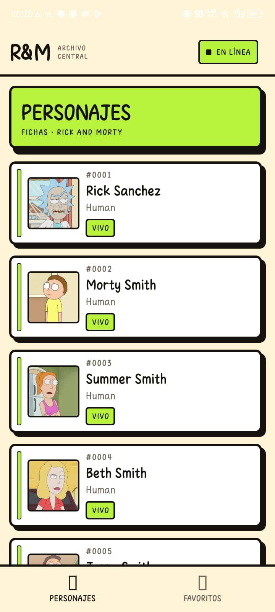
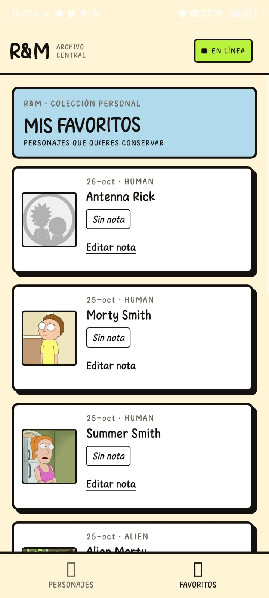

# Deber4 · Archivo central de Rick and Morty

Aplicación móvil construida con Expo y React Native. Permite explorar personajes de Rick and Morty, guardar favoritos con notas personales en MockAPI y mantener la caché y las mutaciones pendientes entre sesiones y periodos sin conexión.

## Capturas de la aplicación

<table>
  <tr>
    <td align="center"><strong>Personajes</strong></td>
    <td align="center"><strong>Favoritos</strong></td>
  </tr>
  <tr>
    <td></td>
    <td></td>
  </tr>
</table>

## Funcionalidades

- Catálogo paginado de personajes y fichas de detalle desde la API pública de [Rick and Morty](https://rickandmortyapi.com/documentation).
- Creación de favoritos con una nota y edición posterior de esa nota.
- Persistencia de consultas y mutaciones pendientes mediante TanStack Query y AsyncStorage.
- Reanudación automática de mutaciones al recuperar la conexión.
- Indicador del estado de red y de favoritos pendientes en la interfaz.
- Logs con hora para mostrar solicitudes, pausas por falta de conexión, restauración de caché y reintentos de envío.

## Requisitos

- Node.js y npm.
- Una cuenta de MockAPI y un recurso llamado `favoritos`.
- Para instalar el APK en un dispositivo Android: Android Platform Tools (`adb`) y depuración USB habilitada si se quieren consultar los logs del dispositivo desde una computadora.

## Configurar el proyecto

1. Instala las dependencias:

   ```bash
   npm install
   ```

2. Copia `.env.example` a `.env` y configura las URLs:

   ```env
   EXPO_PUBLIC_API_URL=https://TU-ID.mockapi.io/
   EXPO_PUBLIC_RICKMORTY_URL=https://rickandmortyapi.com/api
   ```

   `EXPO_PUBLIC_API_URL` debe ser la URL base de tu proyecto de MockAPI. Crea dentro de ese proyecto el recurso `favoritos`. La API de Rick and Morty es pública y no necesita clave. No publiques credenciales privadas; las variables `EXPO_PUBLIC_` se incluyen en el cliente de la app.

3. Inicia la aplicación:

   ```bash
   npx expo start
   ```

   Escanea el QR con Expo Go o abre la app en un emulador compatible.

## Claves de consulta e invalidación

Las claves se definen en `src/config/queryKeys.ts` y separan los datos del catálogo de los datos propios:

| Clave | Uso |
| --- | --- |
| `personajes.all` | Prefijo para todas las consultas del catálogo. |
| `personajes.lista(pagina)` | Lista de personajes de una página específica. |
| `personajes.detalle(id)` | Detalle de un personaje por ID. |
| `favoritos.all` | Prefijo para todas las consultas de favoritos propios. |
| `favoritos.lista()` | Colección de favoritos obtenida desde MockAPI. |
| `favoritos.detalle(id)` | Espacio de clave para un favorito individual. |

Al terminar la creación o edición de un favorito, se invalida `favoritos.all`. Así se marca como desactualizada la lista y cualquier consulta de detalle de favoritos que comparta ese prefijo, para que los datos se vuelvan a consultar desde MockAPI cuando corresponda. El catálogo público es de solo lectura, por lo que sus consultas no se invalidan después de estas mutaciones.

Las mutation keys son `favoritos.crear` y `favoritos.editar`. Las funciones de mutación y su invalidación están configuradas en `src/config/queryClient.ts`.

## Caché y persistencia

La aplicación usa `PersistQueryClientProvider`, `@tanstack/query-async-storage-persister` y AsyncStorage para conservar la caché localmente. Al iniciar, el provider restaura los datos persistidos; la interfaz puede mostrar datos guardados mientras una nueva solicitud se resuelve.

| Datos | `staleTime` | `gcTime` | Motivo |
| --- | ---: | ---: | --- |
| API pública | 45 minutos | 3 días | El catálogo cambia poco; se reduce la frecuencia de solicitudes y se conservan páginas visitadas. |
| Favoritos en MockAPI | 30 segundos | 1 día | Los favoritos son datos propios y pueden cambiar con más frecuencia. |
| Persistencia (`maxAge`) | — | 1 día | Tiempo máximo durante el que se acepta la caché persistida. |

Estos valores están en `src/config/cacheConfig.ts`. `gcTime` es igual o mayor que `maxAge` en ambas categorías. Si `gcTime` fuera menor que `maxAge`, TanStack Query podría retirar de memoria una consulta inactiva antes de que expire su copia persistida; por eso el tiempo de vida en disco, por sí solo, no garantizaría que esa consulta siguiera disponible en memoria durante todo el periodo esperado.

## Mutaciones sin conexión

Las operaciones de creación (`POST favoritos`) y edición (`PUT favoritos/:id`) usan TanStack Query. Con la configuración de red predeterminada, si se inicia una mutación sin conexión, queda pausada y aparece como pendiente en Favoritos. El provider persiste la mutación pendiente; sus mutation keys y funciones predeterminadas permiten reanudarla al restaurar la caché. Cuando vuelve la conexión, la app envía el cambio y después invalida `favoritos.all`.

Los logs generados por la app incluyen la hora local. Los mensajes estan en espanol y usan caracteres simples para facilitar su lectura en Android Logcat. Por ejemplo:

```text
[11:17:38.401] CAMBIO_PENDIENTE metodo=POST recurso=favoritos personajeId=1 motivo=sin_conexion
[11:18:02.821] Cache restaurada desde AsyncStorage. Cambios pendientes: 1
[11:18:02.822] POST favoritos enviando a MockAPI
[11:18:03.450] POST favoritos correcto id=...
```

## Crear e instalar el APK de demostración

El perfil `preview` de `eas.json` genera un APK de distribución interna para Android:

```bash
npx eas-cli@latest login
npx eas-cli@latest build -p android --profile preview
```

Al finalizar, EAS proporciona un enlace para descargar e instalar el APK. Configura en el entorno `preview` de EAS las mismas variables de entorno necesarias para la app; EAS Build no lee automáticamente el archivo `.env` local.

## Protocolo de demostración

Realiza la demostración desde el APK instalado, no solo desde Expo Go:

1. Con el dispositivo conectado a internet, abre la app y muestra que la lista de personajes se carga.
2. Desactiva Wi-Fi y datos móviles o activa el modo avión. Abre un personaje, escribe una nota y toca **Guardar en favoritos**.
3. En **Favoritos**, muestra el favorito con la etiqueta **PENDIENTE · SIN SEÑAL**. En los logs debe aparecer `CAMBIO_PENDIENTE`; al editar una nota sin conexión aparecerá `metodo=PUT`.
4. Espera unos segundos para permitir que se guarde la caché persistida y cierra la app por completo desde la vista de aplicaciones recientes.
5. Vuelve a activar la red y abre la app. Muestra la lista disponible desde la caché y los logs que indican la restauración y el envío automático del pendiente.
6. Abre el recurso `favoritos` en el panel de MockAPI y confirma que el nuevo registro está allí.

Para ver los logs de un **APK instalado**, conecta el dispositivo Android por USB con la depuración USB habilitada y ejecuta:

```powershell
adb logcat -v time ReactNativeJS:I "*:S" | ForEach-Object { $_ -replace '^.*?ReactNativeJS\(\d+\):\s*', '' }
```

Ejecuta el comando en PowerShell y déjalo activo durante la demostración. El filtro muestra solo los mensajes de React Native y quita el prefijo de Android para facilitar la lectura. En Android Studio también puedes abrir **Logcat**, seleccionar el dispositivo y filtrar por `ReactNativeJS`. En Expo Go, los logs aparecen en la terminal que ejecuta `npx expo start`; la terminal de Expo no captura automáticamente los logs de un APK independiente.

Después de cambiar el código de logging o de conexión, vuelve a generar e instalar el APK para que los cambios estén incluidos. Un APK instalado anteriormente no recibe estos cambios automáticamente.
 
## Comandos de verificación

```bash
npm run lint
npx tsc --noEmit
```

## Estructura principal

- `src/app/`: pantallas de personajes y favoritos.
- `src/api/`: clientes y servicios para Rick and Morty y MockAPI.
- `src/hooks/`: consultas y mutaciones de TanStack Query.
- `src/config/`: claves, caché, persistencia y configuración del cliente.
- `src/types/`: tipos de personajes y favoritos.
